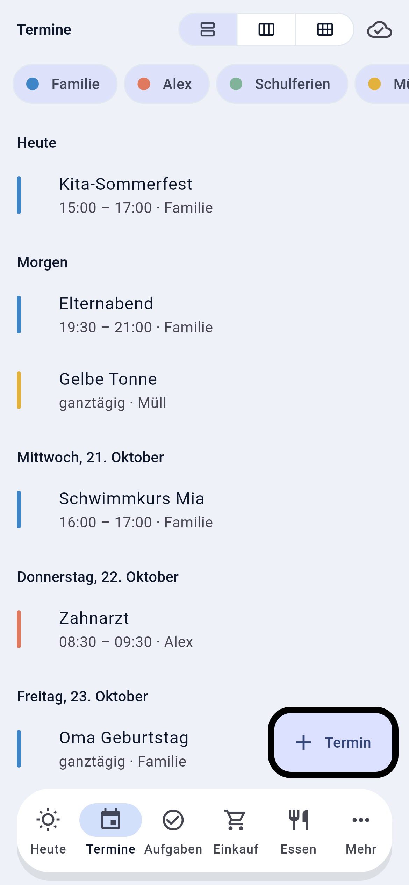
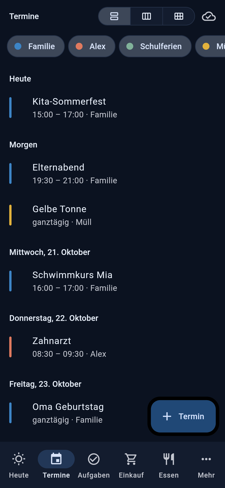
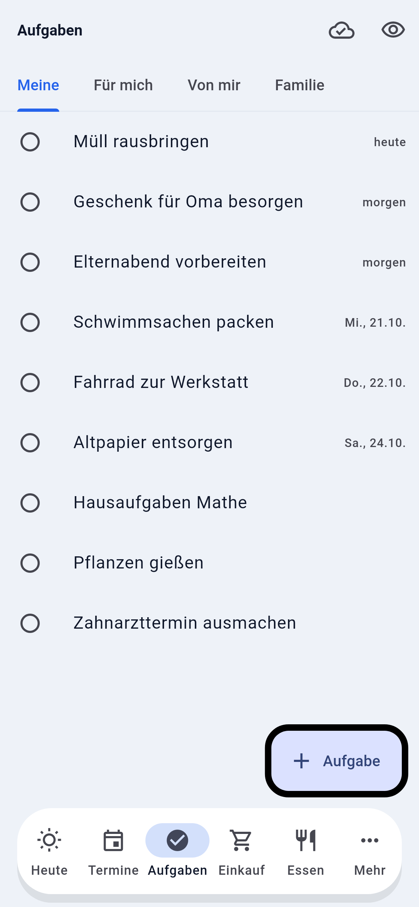
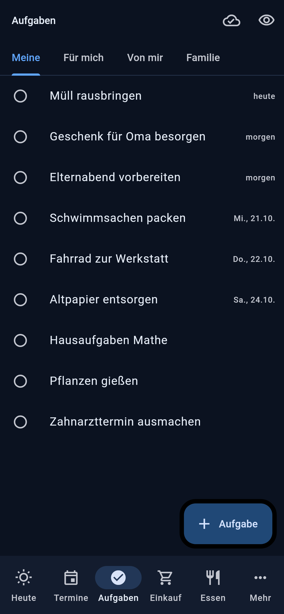
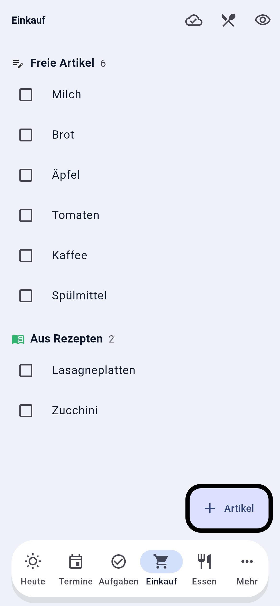
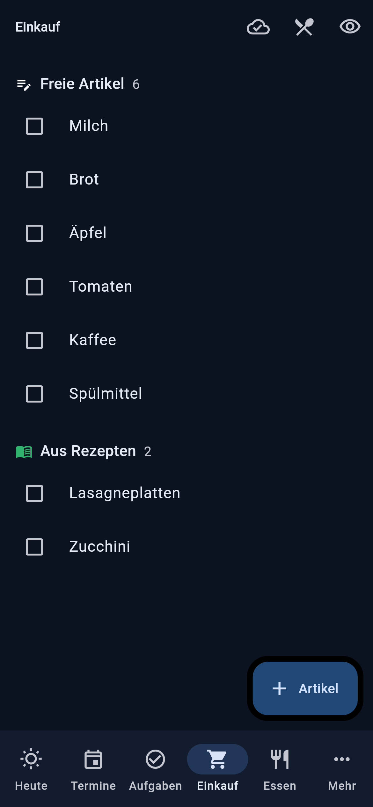
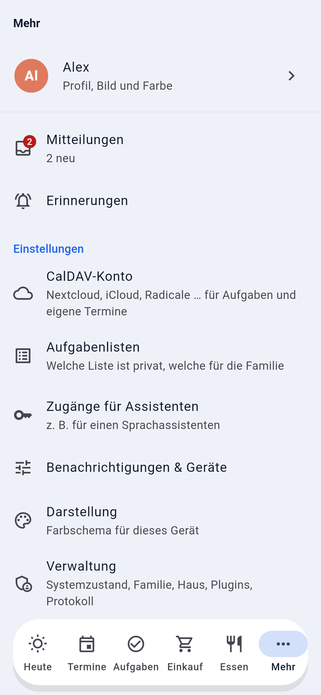
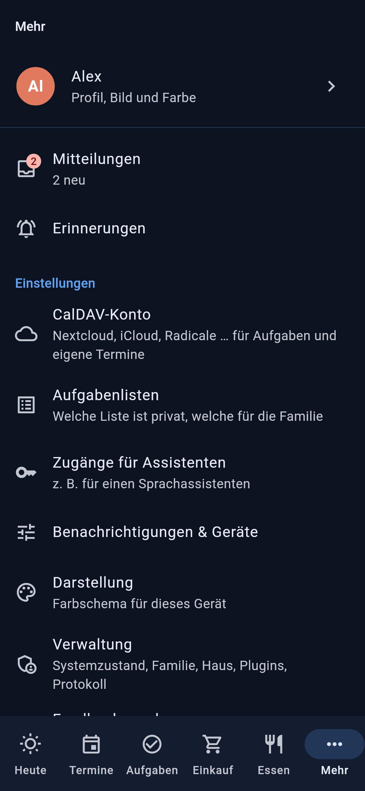
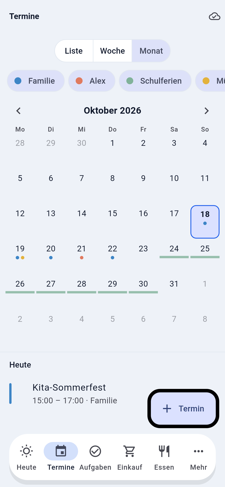
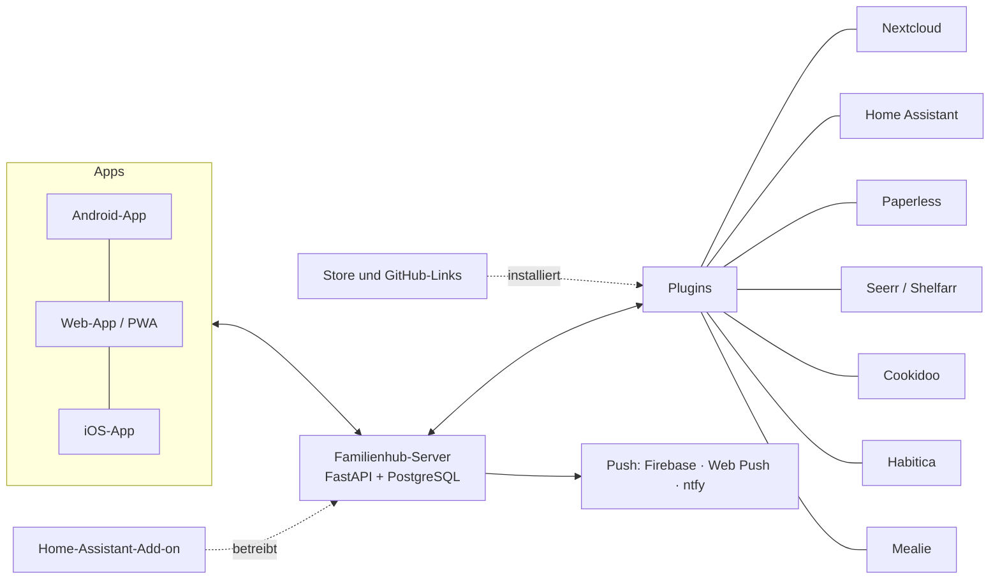

<div align="center">

# Familienhub

**Der selbst gehostete Familien-Hub, der allein funktioniert und anbindet, was ihr schon betreibt.**

[](https://github.com/Brottuetchen/familienhub/releases/latest) [](LICENSE) [](https://github.com/Brottuetchen/familienhub/discussions)

   

📖 **[Dokumentation (Website, englisch)](https://brottuetchen.github.io/familienhub/)** · 💬 **[Wiki](https://github.com/Brottuetchen/familienhub/wiki)** (Anleitungen, FAQ, Fehlerbehebung)

[Installation](#installation) · [Was es kann](#was-es-kann) · [Umfeld](#umfeld) · [Roadmap](docs/roadmap.md) · [Mitmachen](#mitmachen) · [English](README.md)

</div>

Familienhub gibt jedem in der Familie eine App für das, was heute ansteht: Aufgaben, Einkauf, Essen, Termine und Erinnerungen. Es läuft auf eurem eigenen Server (ein Docker-Container plus PostgreSQL), hat echte Push-Mitteilungen, Android-Widgets und einen Offline-Modus und braucht keinen weiteren Dienst, um nützlich zu sein. Wenn ihr schon Nextcloud, Home Assistant, Paperless oder Mealie betreibt, zeigt der Hub diese Daten ebenfalls an und lässt sie, wo sie sind.

Die ausführliche Doku ist auf Englisch; die Links unten führen dorthin.

## Was es kann

### Alltag

- **Heute:** ein Bildschirm mit Aufgaben, Einkauf, Terminen, Essen, Erinnerungen und Haus-Kacheln. Jeder ordnet seinen eigenen (Reihenfolge, ein-/ausblenden, halbe oder volle Größe); Admins legen den Familienstandard fest. [Mehr](docs/getting-started.md#6-plugins)
- **Aufgaben:** eigene, gemeinsame und zugewiesene, mit Haushaltsrotation. Im Hub, in CalDAV/Nextcloud oder Habitica, auch nebeneinander. [Aufgaben und Plugins](docs/plugins.md#tasks-where-a-task-lands)
- **Einkaufsliste:** die Liste des Hubs, zusammengeführt mit Listen aus Home Assistant, Mealie oder Cookidoo. [Plugins](docs/plugins.md)
- **Essen und Rezepte:** Wochenplan, Rezeptbuch, Zutaten auf die Einkaufsliste, [Rezept-Import per Link](docs/recipe-import.md) und wiederverwendbare [Vorlagenlisten](docs/templates.md) (Packliste, Wocheneinkauf).
- **Kalender:** Liste, Woche und Monat; CalDAV, ICS-Abos und ein Familienkalender im Hub; Terminerinnerungen. [Kalender und Handy](docs/calendar.md)
- **Erinnerungen:** zu einer Zeit, wiederkehrend oder *wenn ich heimkomme* (über Home Assistant), mit Aktionsknöpfen in der Mitteilung. [Mitteilungen](docs/notifications.md)

### Familie

- **Kindermodus:** Sterne für Aufgaben, Belohnungen und Wünsche, die Eltern freigeben. [Kindermodus](docs/kids-mode.md)
- **Geburtstage und Jahrestage:** jährlich, im Kalender und auf Heute, mit Geschenkideen, die das Geburtstagskind nicht sieht. [Geburtstage](docs/birthdays.md)
- **Stundenplan für Kinder:** Unterricht, Sport und Vereine je Kind, optional A/B-Wochen und Schulferien. [Stundenplan](docs/timetable.md)
- **Rollen und Einladungen:** Admin, Partner, Kind und Gast, vom Server durchgesetzt. [Rollen](docs/security.md#roles)

### Haus und Dienste

- **Home Assistant:** Zustands-Kacheln, Licht, Schalter und Szenen, Einkaufslisten, Erinnerungen „wenn ich heimkomme“. [Plugins](docs/plugins.md)
- **Sprachassistent:** Einkauf, Aufgaben, Essen, Termine und Erinnerungen über Home Assistant Assist. [Sprachassistent](docs/voice-assistant.md)
- **Paperless, Seerr, Shelfarr:** Dokumente durchsuchen und Fristen als Erinnerung; Filme, Serien und Bücher wünschen. [Plugins](docs/plugins.md)
- **Mitteilungen aus anderen Systemen:** Home Assistant, Shelfarr, Paperless und eigene Skripte können an den Hub senden. [Mitteilungsquellen](docs/notification-sources.md)

### Verwaltung und Sicherheit

- **Einrichtungs-Assistent und Verwaltung:** Wer zuerst öffnet, legt das Admin-Konto an, danach wählt ihr die Quelle je Bereich. [Einstieg](docs/getting-started.md)
- **Sicherung und Wiederherstellung:** eine ZIP-Datei aus der App, optional nächtliche Sicherungen. [Sicherung](docs/getting-started.md#7-backup)
- **Update-Hinweis:** Die Verwaltung zeigt, wenn es eine neuere Version gibt; abschaltbar. [Update](docs/getting-started.md#8-update)
- **Anmeldung:** lokale Konten oder OIDC (Authentik, Keycloak …). Passkeys und 2FA sind nicht eingebaut; nutzt sie über euren Identitätsanbieter. [Sicherheit](docs/security.md)
- **Mitteilungskanäle:** Firebase, Web Push und ntfy, mit Ruhezeiten und Kategorien. [Mitteilungen](docs/notifications.md)

### Anpassbar

- **Themes:** Hell/Dunkel-Varianten und Schriften; elf in der [Galerie](https://github.com/Brottuetchen/familienhub-themes). [Themes](docs/themes.md)
- **Store:** geprüfte Plugins und Themes in der Verwaltung finden und installieren. [Store](docs/store.md)
- **Plugins aus GitHub:** Link einfügen, prüfen, läuft ohne Neustart. Eigene schreiben mit der [Vorlage](examples/plugin-template/). [Plugins](docs/plugins.md)

### Apps

- **Android:** App mit Widgets, Schnellaktionen und Offline-Warteschlange. [Apps besorgen](docs/getting-started.md#3-get-the-apps)
- **Web-App (PWA):** im Browser installierbar; Web Push funktioniert auch dort. [Mitteilungen](docs/notifications.md)
- **iOS:** App zum Sideloaden aus dem Release; Push über ntfy. TestFlight und Widgets brauchen eine Apple-Lizenz, siehe [#9](https://github.com/Brottuetchen/familienhub/issues/9). [iPhone](docs/notifications.md#iphone)
- **Sprachen:** Deutsch und Englisch.

<details>
<summary>Weitere Screenshots</summary>

   

   

 

</details>

## Installation

### Docker

```bash
mkdir familienhub && cd familienhub
curl -fsSLO https://raw.githubusercontent.com/Brottuetchen/familienhub/main/docker-compose.yml
# Stabiles Image (:latest). Eine Version festnageln, wenn ihr selbst entscheidet, wann aktualisiert wird:
# FAMILIENHUB_VERSION=1.0.0 docker compose up -d
docker compose up -d
```

Es ist keine Konfiguration nötig. Dann `http://<host>:8000` im Browser öffnen (oder die Adresse in der App eintragen): Wer einen neuen Hub zuerst öffnet, legt das Admin-Konto an, danach führt der Einrichtungs-Assistent durch den Rest. Ist der Hub vor der Einrichtung aus dem Internet erreichbar, `SETUP_REQUIRE_CODE=true` setzen (siehe [Sicherheit](docs/security.md#first-admin-and-secret-key), englisch). Mehr dazu (Reverse-Proxy, Selbst bauen, Sicherung) im [Einstieg](docs/getting-started.md) (englisch).

### Home-Assistant-Add-on (experimentell)

[](https://my.home-assistant.io/redirect/supervisor_add_addon_repository/?repository_url=https%3A%2F%2Fgithub.com%2FBrottuetchen%2Ffamilienhub-ha-addon)

Das Add-on betreibt den Hub in Home Assistant (SQLite, Daten in `/data`) und ist auf Port 8000 erreichbar. Der Hub kann bereits unter einem Ingress-Pfad laufen ([Details](docs/home-assistant.md), englisch). Den Eintrag in der Home-Assistant-Seitenleiste liefert erst ein Add-on-Release, das Ingress einschaltet ([#28](https://github.com/Brottuetchen/familienhub/issues/28)). Mehr im [Add-on-Repository](https://github.com/Brottuetchen/familienhub-ha-addon).

### Apps

APK und IPA hängen an jedem [GitHub-Release](https://github.com/Brottuetchen/familienhub/releases/latest). Android: APK installieren. iPhone: IPA sideloaden oder die Web-App nutzen. Siehe [Apps besorgen](docs/getting-started.md#3-get-the-apps) (englisch).

## So funktioniert es



- **Server:** ein Docker-Container (FastAPI, liefert auch die Web-App aus) plus PostgreSQL.
- **Bereiche und Quellen:** Jeder Bereich (Aufgaben, Einkauf, Kalender …) hat austauschbare Quellen: den Speicher des Hubs und Plugins. Der Admin wählt je Bereich. Persönliche Daten werden nur mit dem eigenen Zugang gelesen.
- **Plugins aus GitHub:** Admins fügen einen Link ein oder wählen einen Eintrag im [Store](docs/store.md), prüfen das Plugin und tragen die Einstellungen ein; es läuft ohne Neustart.
- **App:** Flutter, eine Codebasis für Android, iOS und Web. Lesen geht zuerst aus dem Zwischenspeicher, Änderungen offline werden in eine Warteschlange gelegt.

### Bereiche und Quellen

| Bereich | Im Hub | Oder aus (Plugins) |
|---|:-:|---|
| Aufgaben | ✓ | CalDAV (Nextcloud, iCloud, Radicale …), Habitica, auch mehrere nebeneinander |
| Einkaufsliste | ✓ | Home Assistant, Mealie |
| Kalender | ✓ Familienkalender | CalDAV, Kalender-Abos (ICS), alles zusammen |
| Essensplan & Rezepte | ✓ Wochenplan und Rezeptbuch | Mealie (Rezepte, Essensplan), Cookidoo (Rezepte), Home Assistant (Cookidoo-Plan) |
| Erinnerungen, Mitteilungen | ✓ | Home Assistant, Shelfarr, Paperless … als Mitteilungsquellen |
| Dokumente · Bücher · Filme & Serien | – | Paperless-ngx · Shelfarr · Seerr |

Die Quelle jedes Bereichs wählt der Admin im Einrichtungs-Assistenten oder unter *Verwaltung → Quellen je Bereich*.

## Umfeld

| Repository | Was es ist |
|---|---|
| [familienhub-store](https://github.com/Brottuetchen/familienhub-store) | Der geprüfte Index für Plugins und Themes hinter dem [Store](docs/store.md) in der App |
| [familienhub-themes](https://github.com/Brottuetchen/familienhub-themes) | Theme-Galerie mit Hell- und Dunkel-Vorschau, per Link installierbar |
| [familienhub-ha-addon](https://github.com/Brottuetchen/familienhub-ha-addon) | Home-Assistant-Add-on (experimentell) |
| [Plugin-Vorlage](examples/plugin-template/) | Ausgangspunkt für ein eigenes Plugin, siehe [Plugin-Anleitung](docs/plugins.md) |

## Mitmachen

- **Fragen und Zeigen:** [GitHub Discussions](https://github.com/Brottuetchen/familienhub/discussions).
- **Fehler oder Wunsch melden:** [Issue anlegen](https://github.com/Brottuetchen/familienhub/issues), auch auf Deutsch, oder in der App *Mehr → Feedback senden*.
- **Code beitragen:** [CONTRIBUTING](CONTRIBUTING.md) (englisch) beschreibt Entwicklungsumgebung und Pull Requests. Plugins und Themes können in eigenen Repositories liegen.
- **Übersetzen helfen:** Weitere Sprachen sind willkommen, ganz ohne Git. Das Weblate-Projekt folgt ([#25](https://github.com/Brottuetchen/familienhub/issues/25)); bis dahin siehe [Translations](CONTRIBUTING.md#translations) (englisch).
- **Sicherheitslücke:** bitte privat melden, siehe [SECURITY.md](SECURITY.md).
- **Wie geht es weiter:** die [Roadmap](docs/roadmap.md).

## Status

Familienhub **1.0.0** ist das aktuelle stabile Release und wird seit Oktober 2026 täglich vom ersten Haushalt genutzt. Rechnet mit Ecken und Kanten; Issues und Ideen sind willkommen. Was sich geändert hat: [Changelog](CHANGELOG.md) (englisch).

## Unterstützen

Familienhub ist kostenlos und entsteht in der Freizeit. Für echte native Apps braucht das Projekt eine Apple-Entwicklerlizenz (99 €/Jahr, für TestFlight, den App Store und Widgets auf dem iPhone, siehe [#9](https://github.com/Brottuetchen/familienhub/issues/9)) und einmalig ein Google-Play-Entwicklerkonto (rund 25 €). Daraus ergibt sich ein Jahresziel von **150 €**. Wenn der Hub eurer Familie hilft, freuen wir uns über jede Unterstützung.

<div align="center">

<!-- annual goal: update the first amount in the badge URL by hand, in both READMEs -->
<a href="https://ko-fi.com/brottuetchen"></a>

<a href="https://ko-fi.com/brottuetchen"></a>&nbsp;&nbsp;<a href="https://github.com/sponsors/Brottuetchen"></a>

</div>

## Lizenz

[AGPL-3.0](LICENSE). Wer eine veränderte Fassung anderen als Dienst anbietet, muss den Quellcode ebenfalls zugänglich machen.
