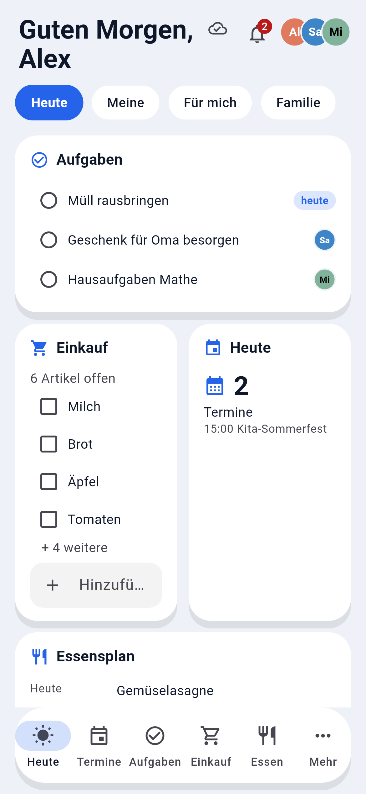
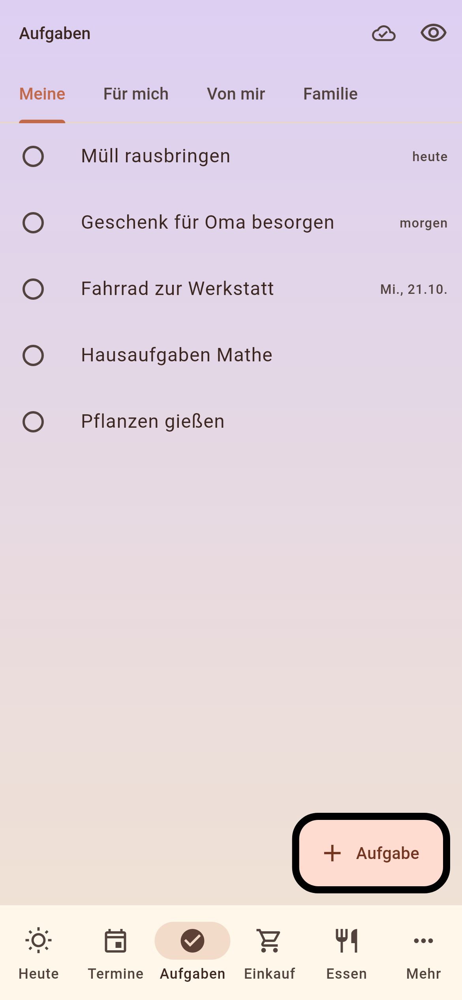
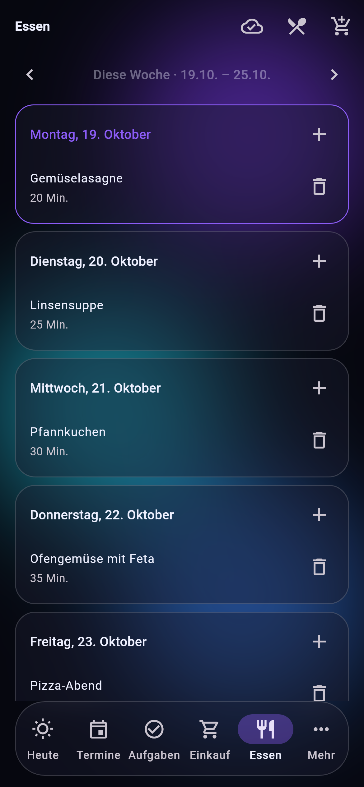
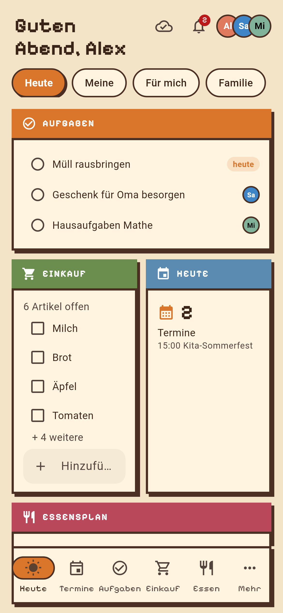
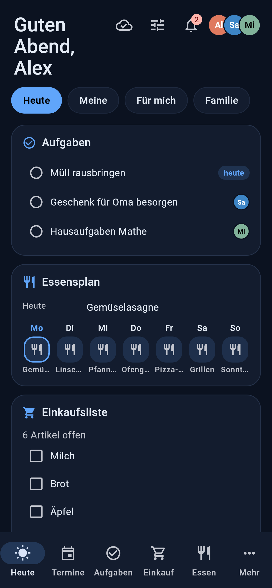
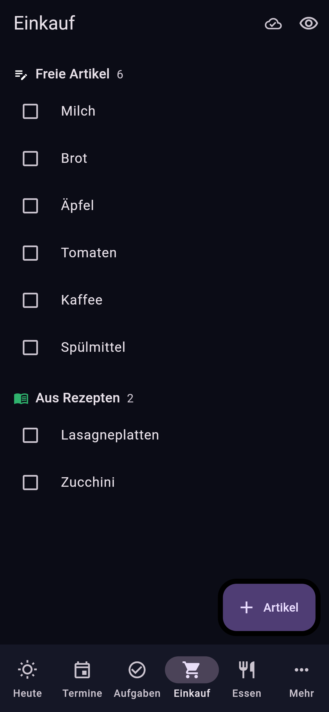
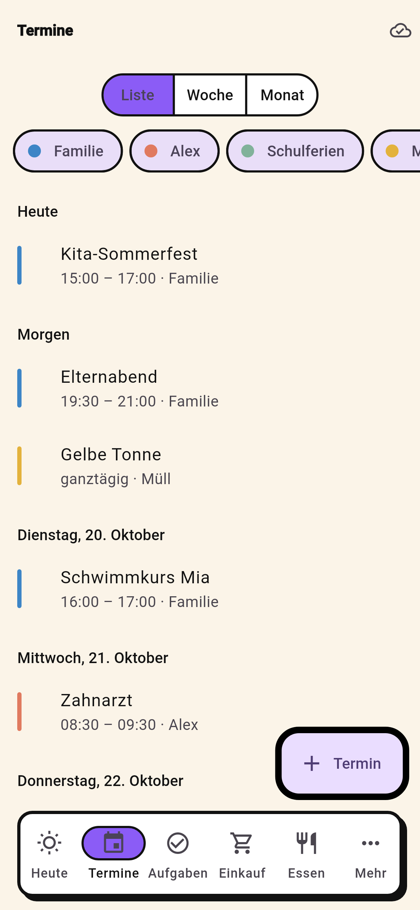
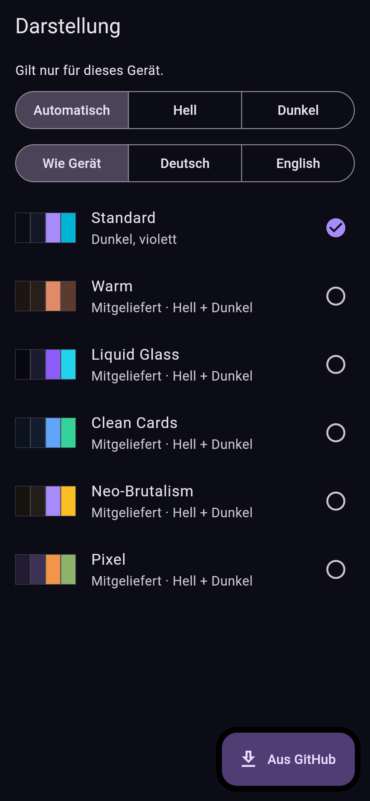

<div align="center">

# Familienhub

**Selbst gehostete Familien-App, die eure vorhandenen Dienste zusammenbringt.**

Heute auf einen Blick, Aufgaben für sich und füreinander, Einkauf, Essensplan, Termine und Erinnerungen, mit echten Push-Mitteilungen, Widgets und Offline-Modus.

[English](README.md) · Die ausführliche Doku ist auf Englisch: [Einstieg](docs/getting-started.md) · [Mitteilungen](docs/notifications.md) · [Plugins](docs/plugins.md) · [Themes](docs/themes.md) · [Roadmap](docs/roadmap.md)

   

</div>

## Warum

Eine App für alle in der Familie, die **allein funktioniert und anbindet, was ihr schon betreibt**.

- **Sofort nutzbar:** Aufgaben, Einkaufsliste, Familienkalender, Essensplan und Erinnerungen speichert der Hub selbst. Ein weiterer Dienst ist nicht nötig.
- **Alles anschließbar:** Jeder Bereich kann seine Daten statt aus dem Hub oder zusätzlich aus einem Dienst holen. Beispiele:
  - Aufgaben aus jedem CalDAV-Server (Nextcloud, iCloud, Radicale …) oder Habitica
  - die Einkaufsliste aus Home Assistant
  - Dokumente aus Paperless
  - und alles, was ein Plugin liefert

  Angebundene Daten bleiben, wo sie sind.

| Bereich | Im Hub | Oder aus (Plugins) |
|---|:-:|---|
| Aufgaben | ✓ | CalDAV (Nextcloud, iCloud, Radicale …), Habitica, auch mehrere nebeneinander |
| Einkaufsliste | ✓ | Home Assistant |
| Kalender | ✓ Familienkalender | CalDAV, Kalender-Abos (ICS), alles zusammen |
| Essensplan & Rezepte | ✓ | Cookidoo |
| Dokumente · Bücher · Filme & Serien | – | Paperless-ngx · Shelfarr · Seerr |

Die Quelle jedes Bereichs wählt der Admin im Einrichtungs-Assistenten oder unter *Verwaltung → Quellen je Bereich*.

## Was es kann

- **Heute:** Begrüßung, Aufgaben (meine / für mich / Familie), Einkauf, Termine, Essensplan, Erinnerungen und Haus-Kacheln auf einem Bildschirm
- **Aufgaben:** eigene, gemeinsame und zugewiesene Aufgaben, Haushaltsrotation; Nextcloud und Habitica nebeneinander
- **Einkauf, Essen, Rezepte:** Einkaufsliste, Wochenplan, Cookidoo-Rezepte einplanen und Zutaten auf die Liste
- **Erinnerungen:** zu einer Zeit, wiederkehrend oder *wenn ich heimkomme* (über Home Assistant), mit Knöpfen direkt in der Mitteilung
- **Haus:** Zustände sowie Licht, Schalter und Szenen aus Home Assistant, ausgewählt vom Admin
- **Dokumente und Medien:** Paperless durchsuchen, Fristen als Erinnerung; Filme, Serien und Bücher wünschen
- **Mitteilungen:** Firebase (Android-App), Web Push (Browser/Web-App) und ntfy (z. B. iPhone), mit Ruhezeiten und Kategorien
- **Familie:** Rollen (Admin, Partner, Kind, Gast), Einladungen, Anmeldung per OIDC (Authentik, Keycloak …) oder lokal
- **Apps:** Android-App mit Widgets und Offline-Warteschlange, Web-App (PWA), iOS-App zum Sideloaden
- **Anpassbar:** Themes mit Hell/Dunkel und Schriften, installierbar aus GitHub; Deutsch und Englisch

<details>
<summary>Weitere Screenshots</summary>

   

</details>

## Schnellstart

```bash
git clone https://github.com/Brottuetchen/familienhub.git && cd familienhub
cp .env.example .env            # SECRET_KEY, POSTGRES_PASSWORD, CORS_ORIGINS eintragen
docker compose up -d --build
docker compose logs familienhub | grep -i code      # Einrichtungscode für das erste Konto
```

Dann den Hub in der App oder im Browser öffnen und **Einrichten** wählen; der Einrichtungs-Assistent führt durch den Rest. Mehr dazu (Reverse-Proxy, Apps, Sicherung) im [Einstieg](docs/getting-started.md).

## Mitmachen

Fehler und Wünsche gern als Issue, auch auf Deutsch, oder direkt aus der App: *Mehr → Feedback senden → An die Entwickler*. Code, Übersetzungen, Themes und Plugins: siehe [CONTRIBUTING](CONTRIBUTING.md).

## Lizenz

[AGPL-3.0](LICENSE). Wer eine veränderte Fassung anderen als Dienst anbietet, muss den Quellcode ebenfalls zugänglich machen.
