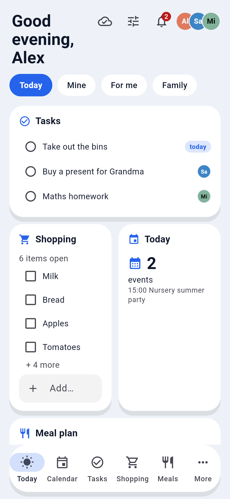
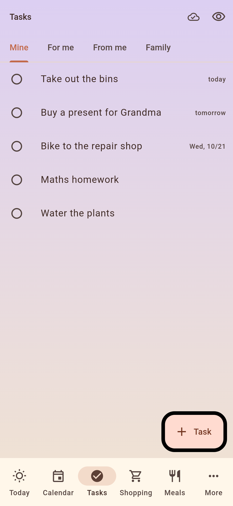
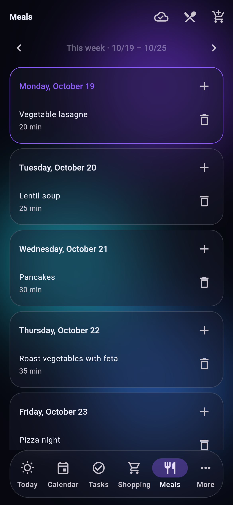
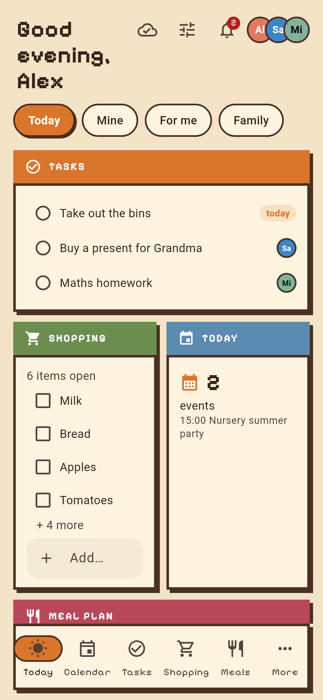
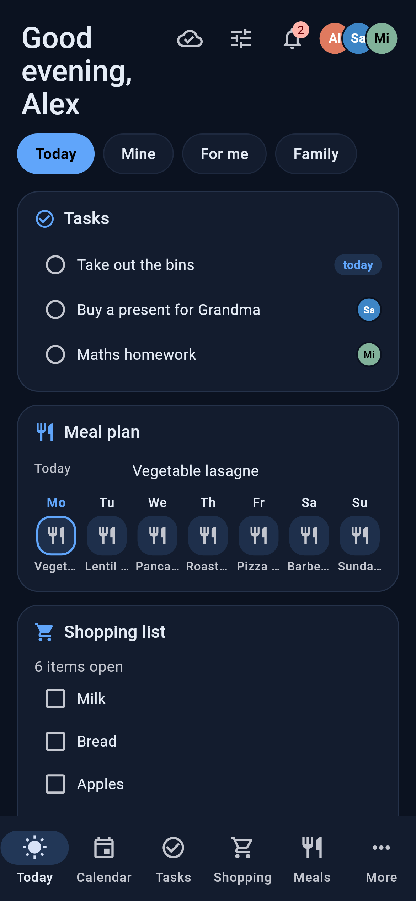
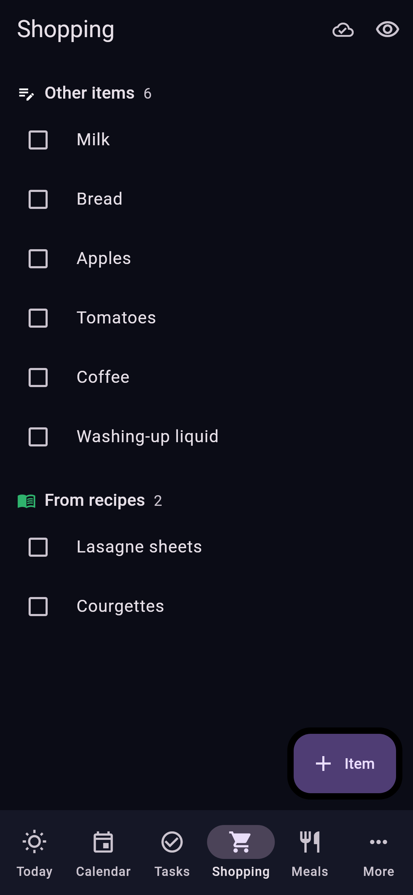
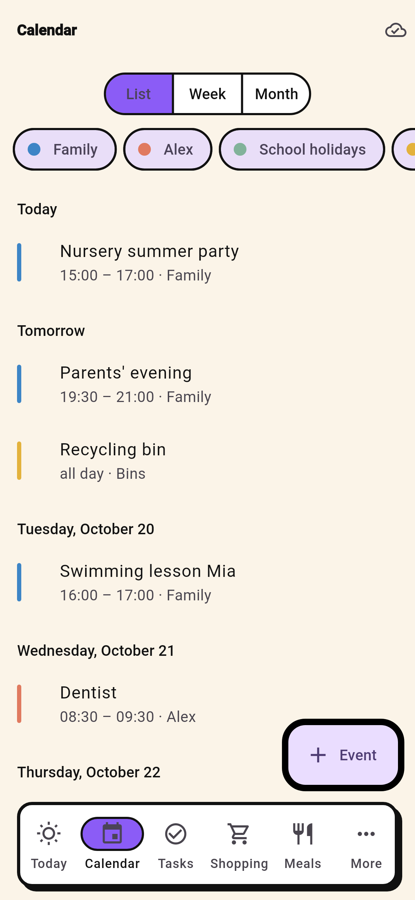
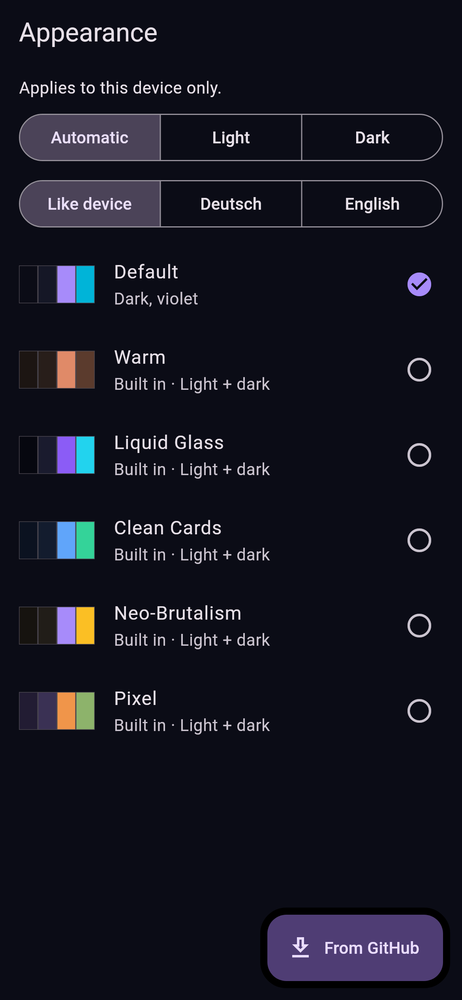
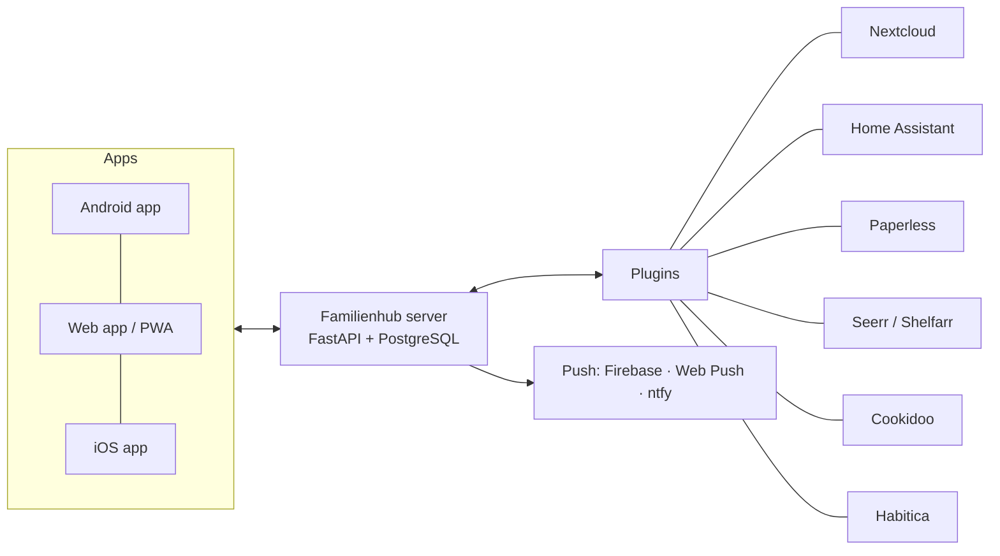

<div align="center">

# Familienhub

**A self-hosted family organiser that brings your existing services together.**

Today at a glance, tasks for yourself and each other, shopping, meal plan, events and reminders, with real push notifications, widgets and offline mode.

[Getting started](docs/getting-started.md) · [Notifications](docs/notifications.md) · [Plugins](docs/plugins.md) · [Themes](docs/themes.md) · [Roadmap](docs/roadmap.md) · [Deutsch](README.de.md)

   

</div>

## Why

One app for everyone in the family, which **works on its own and connects to what you already run**.

- **Out of the box:** tasks, shopping list, family calendar, meal plan and reminders are stored in the hub itself. No other service is needed.
- **Connect anything:** each area can take its data from a service instead of, or in addition to, the hub. Examples:
  - tasks from any CalDAV server (Nextcloud, iCloud, Radicale …) or Habitica
  - the shopping list from Home Assistant
  - documents from Paperless
  - and whatever a [plugin](docs/plugins.md) provides

  Connected data stays where it is. The hub shows it, lets you act on it and notifies the right person.

| Area | In the hub | Or from (plugins) |
|---|:-:|---|
| Tasks | ✓ | CalDAV (Nextcloud, iCloud, Radicale …), Habitica – several side by side |
| Shopping list | ✓ | Home Assistant to-do lists |
| Calendar | ✓ family calendar | CalDAV, calendar subscriptions (ICS), all merged |
| Meal plan & recipes | ✓ | Cookidoo (recipes), Home Assistant (Cookidoo plan) |
| Reminders, notifications | ✓ | Home Assistant, Shelfarr, Paperless … as notification sources |
| Documents · books · movies & shows | – | Paperless-ngx · Shelfarr · Seerr |

Admins choose the source of each area in the setup wizard or under *Administration → Sources per area*.

## Features

- **Today:** greeting, tasks (mine / for me / family), shopping, events, meal plan, reminders and house tiles on one screen
- **Tasks:** own, shared and assigned tasks, household rotation; Nextcloud and Habitica side by side
- **Shopping, meals, recipes:** shopping list, weekly meal plan, Cookidoo recipes onto the plan and ingredients onto the list
- **Reminders:** at a time, recurring, or *when I get home* (via Home Assistant), with buttons right in the notification
- **House:** state tiles and lights/switches/scenes from Home Assistant, chosen by the admin
- **Documents and media:** search Paperless and get deadlines as reminders; request movies, shows and books
- **Notifications:** Firebase (Android app), Web Push (browser / home-screen web app) and ntfy (e.g. iPhones), with quiet hours and categories, see [how it works](docs/notifications.md)
- **Family:** roles (admin, partner, child, guest), invites, sign-in with OIDC (Authentik, Keycloak …) or local accounts
- **Apps:** Android app with widgets and offline queue, web app (PWA), iOS app for sideloading
- **Make it yours:** themes with light/dark variants and fonts, installable from GitHub; German and English

<details>
<summary>More screenshots</summary>

   

</details>

## How it works



- **Server:** one Docker container (FastAPI, serves the web app too) plus PostgreSQL.
- **Areas and sources:** every area (tasks, shopping, calendar …) has interchangeable sources: the hub's own storage and plugins. Admins choose per area. Personal data is only read with each person's own access.
- **App:** Flutter, one codebase for Android, iOS and web. Reads are cache-first, and changes made offline are queued.

## Quick start

```bash
git clone https://github.com/Brottuetchen/familienhub.git && cd familienhub
cp .env.example .env            # set SECRET_KEY, POSTGRES_PASSWORD, CORS_ORIGINS
docker compose up -d --build
docker compose logs familienhub | grep -i code      # setup code for the first admin
```

Open the hub in the app or a browser and choose **Set up**; the setup wizard does the rest. Details, reverse proxy, apps and backups: [getting started](docs/getting-started.md).

## Documentation

| | |
|---|---|
| [Getting started](docs/getting-started.md) | install, reach it, apps, people and sign-in, backup |
| [Notifications](docs/notifications.md) | Firebase, Web Push, ntfy, iPhone; [ntfy setup](docs/ntfy.md) |
| [Notification sources](docs/notification-sources.md) | Home Assistant, Shelfarr, Paperless → `POST /api/notify` |
| [Plugins](docs/plugins.md) | what ships, how to write, install and share a plugin |
| [Themes](docs/themes.md) | the `theme.json` format, how to share a theme |
| [Security](docs/security.md) | principles, roles, public endpoints; [report a vulnerability](SECURITY.md) |
| [Roadmap](docs/roadmap.md) | what's done, next and later |
| [Contributing](CONTRIBUTING.md) | development setup, translations, pull requests |

## Status

Familienhub is used daily by its first family since October 2026 and is approaching its first public release. Expect rough edges; issues and ideas are welcome.

## License

[AGPL-3.0](LICENSE). If you run a modified version as a service for others, you must make your source code available too.
