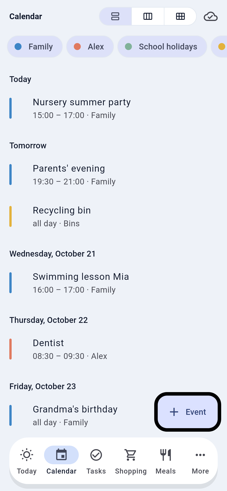
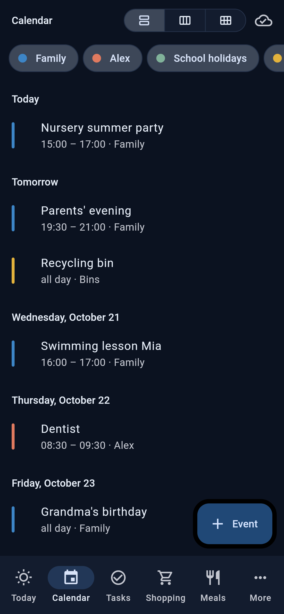
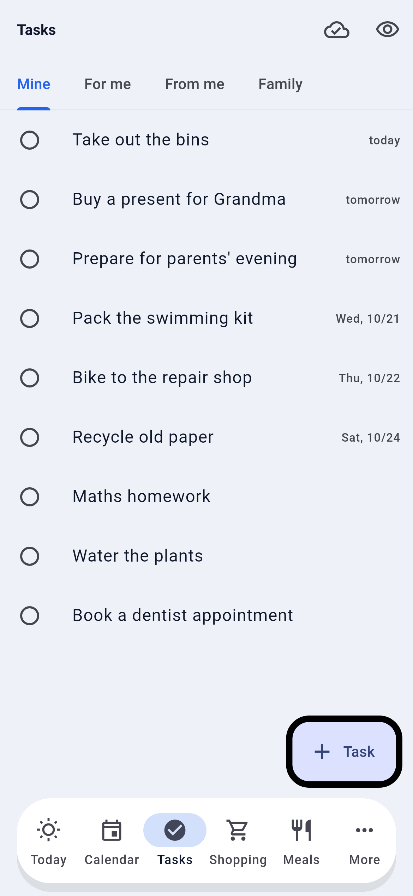
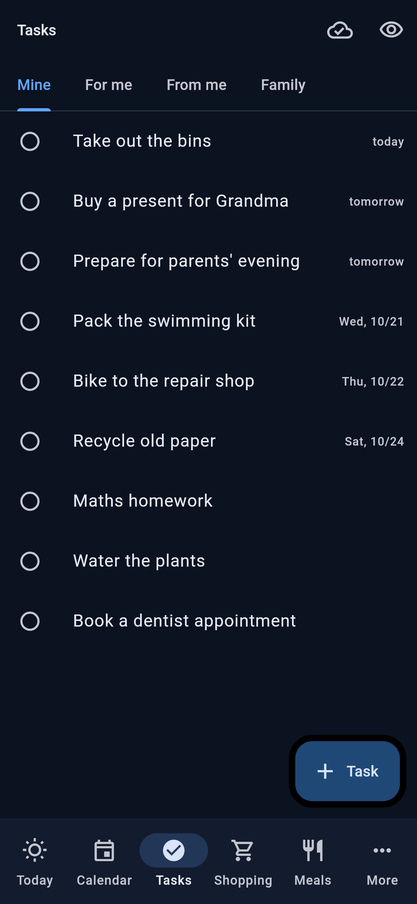
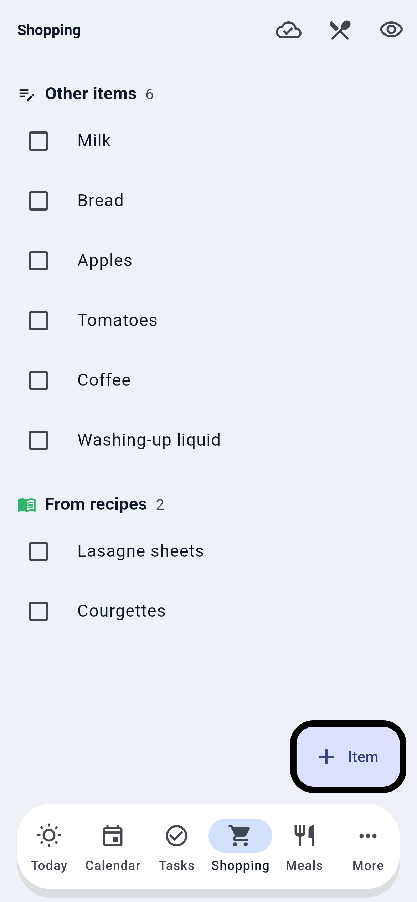
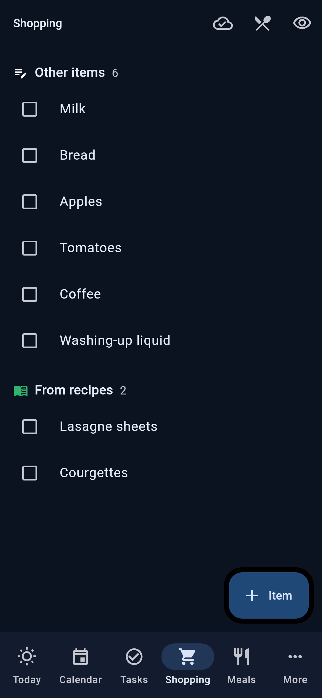
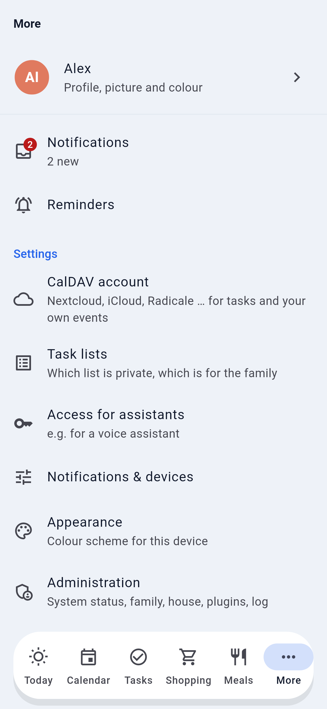
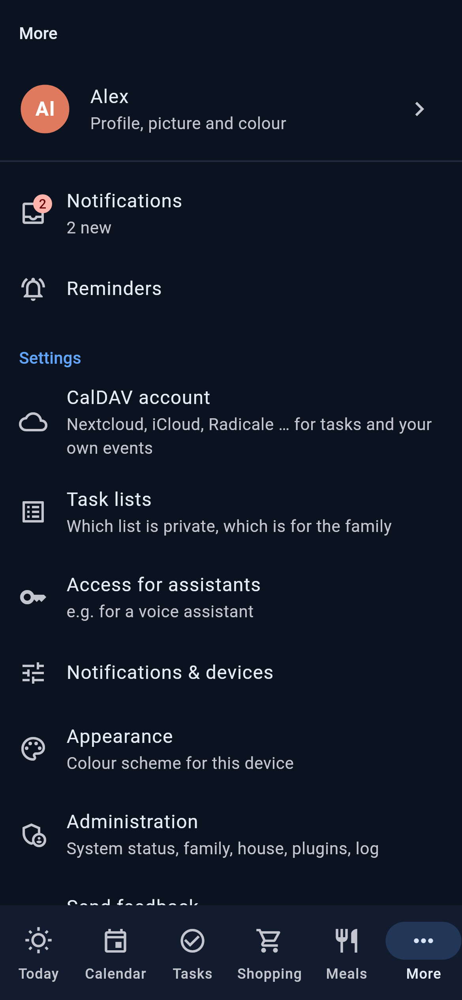
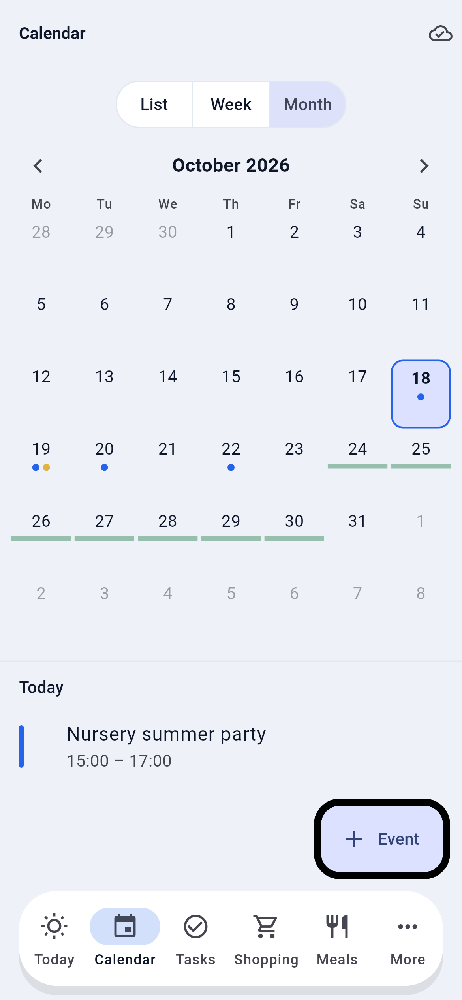
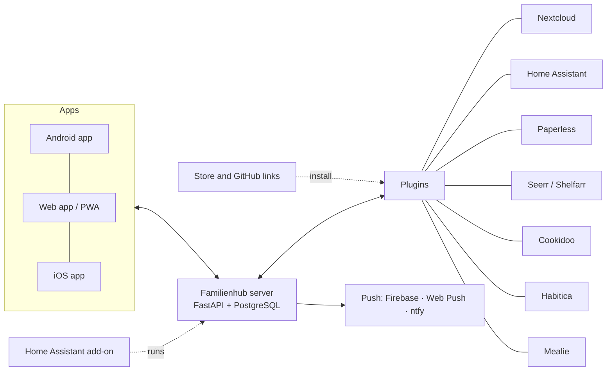

<div align="center">

# Familienhub

**The self-hosted family hub that works on its own and plugs into what you already run.**

[](https://github.com/Brottuetchen/familienhub/releases/latest) [](LICENSE) [](https://github.com/Brottuetchen/familienhub/discussions)

   

📖 **[Documentation website](https://brottuetchen.github.io/familienhub/)** · 💬 **[Wiki](https://github.com/Brottuetchen/familienhub/wiki)** (German how-tos, FAQ, troubleshooting)

[Install](#install) · [Features](#features) · [Ecosystem](#ecosystem) · [Roadmap](docs/roadmap.md) · [Community](#community) · [Deutsch](README.de.md)

</div>

Familienhub gives every person in the family one app for what is on today: tasks, shopping, meals, events and reminders. It runs on your own server (one Docker container plus PostgreSQL), has real push notifications, Android widgets and an offline mode, and needs no other service to be useful. If you already run Nextcloud, Home Assistant, Paperless or Mealie, the hub shows that data too and leaves it where it is.

## Features

Every item links to its documentation.

### Everyday

- **Today:** one screen with tasks, shopping, events, meals, reminders and house tiles. Everyone arranges their own (order, show/hide, half or full size); admins set the family default. [How](docs/getting-started.md#6-plugins)
- **Tasks:** own, shared and assigned, with household rotation. In the hub, on CalDAV/Nextcloud or Habitica, side by side. [Tasks and plugins](docs/plugins.md#tasks-where-a-task-lands)
- **Shopping list:** the hub's own list, merged with Home Assistant, Mealie or Cookidoo lists. [Plugins](docs/plugins.md)
- **Meals and recipes:** weekly meal plan, recipe book, ingredients to the shopping list, [recipe import from a link](docs/recipe-import.md) and reusable [template lists](docs/templates.md) (packing list, weekly shopping).
- **Calendar:** list, week and month views; CalDAV, ICS subscriptions and a family calendar in the hub; event reminders. [Calendar and phone](docs/calendar.md)
- **Reminders:** at a time, recurring, or *when I get home* (via Home Assistant), with action buttons in the notification. [Notifications](docs/notifications.md)

### Family

- **Kids mode:** stars for tasks, rewards and requests that parents approve. [Kids mode](docs/kids-mode.md)
- **Birthdays and anniversaries:** yearly, in the calendar and on Today, with gift ideas the birthday person cannot see. [Birthdays](docs/birthdays.md)
- **Timetable for children:** lessons, sports and clubs per child, optional A/B weeks and school holidays. [Timetable](docs/timetable.md)
- **Roles and invites:** admin, partner, child and guest, enforced by the server. [Roles](docs/security.md#roles)

### Home and services

- **Home Assistant:** state tiles, lights, switches and scenes, shopping lists, "when I get home" reminders. [Plugins](docs/plugins.md)
- **Voice assistant:** shopping, tasks, meals, events and reminders through Home Assistant Assist. [Voice assistant](docs/voice-assistant.md)
- **Paperless, Seerr, Shelfarr:** search documents and get deadlines as reminders; request movies, shows and books. [Plugins](docs/plugins.md)
- **Notifications from other systems:** Home Assistant, Shelfarr, Paperless and your own scripts can post to the hub. [Notification sources](docs/notification-sources.md)

### Admin and safety

- **Setup wizard and admin panel:** the first person creates the admin account, then you pick the source for each area. [Getting started](docs/getting-started.md)
- **Backup and restore:** one ZIP from the app, optional nightly backups. [Backup](docs/getting-started.md#7-backup)
- **Update notice:** Administration shows when a newer release exists; you can switch it off. [Update](docs/getting-started.md#8-update)
- **Sign-in:** local accounts or OIDC (Authentik, Keycloak ...). Passkeys and 2FA are not built in; use them through your identity provider. [Security](docs/security.md)
- **Notification channels:** Firebase, Web Push and ntfy, with quiet hours and categories. [Notifications](docs/notifications.md)

### Make it yours

- **Themes:** light and dark variants and fonts; eleven in the [gallery](https://github.com/Brottuetchen/familienhub-themes). [Themes](docs/themes.md)
- **Store:** find and install reviewed plugins and themes in Administration. [Store](docs/store.md)
- **Plugins from GitHub:** paste a link, review, run, no restart. Write your own from the [template](examples/plugin-template/). [Plugins](docs/plugins.md)

### Apps

- **Android:** app with widgets, quick actions and an offline queue. [Get the apps](docs/getting-started.md#3-get-the-apps)
- **Web app (PWA):** install it from the browser; Web Push works there too. [Notifications](docs/notifications.md)
- **iOS:** app for sideloading from the release; push through ntfy. TestFlight and widgets need an Apple licence, see [#9](https://github.com/Brottuetchen/familienhub/issues/9). [iPhone notes](docs/notifications.md#iphone)
- **Languages:** German and English.

<details>
<summary>More screenshots</summary>

   

   

 

</details>

## Install

### Docker

```bash
mkdir familienhub && cd familienhub
curl -fsSLO https://raw.githubusercontent.com/Brottuetchen/familienhub/main/docker-compose.yml
# Stable image (:latest). Pin a release to upgrade on your own schedule:
# FAMILIENHUB_VERSION=1.0.1 docker compose up -d
docker compose up -d
```

No configuration needed. Open `http://<host>:8000` in a browser (or enter that address in the app): the first person to open a new hub creates the admin account, then the setup wizard does the rest. If the hub is reachable from the internet before setup, set `SETUP_REQUIRE_CODE=true` (see [security](docs/security.md#first-admin-and-secret-key)). Details, reverse proxy, building from source and backups: [getting started](docs/getting-started.md).

### Home Assistant add-on (experimental)

[](https://my.home-assistant.io/redirect/supervisor_add_addon_repository/?repository_url=https%3A%2F%2Fgithub.com%2FBrottuetchen%2Ffamilienhub-ha-addon)

The add-on runs the hub inside Home Assistant (SQLite, data in `/data`) and opens on port 8000. The hub already serves under an ingress prefix ([details](docs/home-assistant.md)). The sidebar entry still needs an add-on release that turns ingress on ([#28](https://github.com/Brottuetchen/familienhub/issues/28)). More in the [add-on repository](https://github.com/Brottuetchen/familienhub-ha-addon).

### Apps

APK and IPA are attached to each [GitHub release](https://github.com/Brottuetchen/familienhub/releases/latest). Android: install the APK. iPhone: sideload the IPA, or use the web app. See [get the apps](docs/getting-started.md#3-get-the-apps).

## How it works



- **Server:** one Docker container (FastAPI, serves the web app too) plus PostgreSQL.
- **Areas and sources:** every area (tasks, shopping, calendar ...) has interchangeable sources: the hub's own storage and plugins. Admins choose per area. Personal data is only read with each person's own access.
- **Plugins from GitHub:** admins paste a link or pick an entry in the [store](docs/store.md), review the plugin and fill in its settings, and it runs without a restart.
- **App:** Flutter, one codebase for Android, iOS and web. Reads are cache-first, and changes made offline are queued.

### Areas and sources

| Area | In the hub | Or from (plugins) |
|---|:-:|---|
| Tasks | ✓ | CalDAV (Nextcloud, iCloud, Radicale ...), Habitica – several side by side |
| Shopping list | ✓ | Home Assistant to-do lists, Mealie |
| Calendar | ✓ family calendar | CalDAV, calendar subscriptions (ICS), all merged |
| Meal plan & recipes | ✓ weekly plan and recipe book | Mealie (recipes, meal plan), Cookidoo (recipes), Home Assistant (Cookidoo plan) |
| Reminders, notifications | ✓ | Home Assistant, Shelfarr, Paperless ... as notification sources |
| Documents · books · movies & shows | – | Paperless-ngx · Shelfarr · Seerr |

Admins choose the source of each area in the setup wizard or under *Administration → Sources per area*.

## Ecosystem

| Repository | What it is |
|---|---|
| [familienhub-store](https://github.com/Brottuetchen/familienhub-store) | The reviewed index of plugins and themes behind the in-app [store](docs/store.md) |
| [familienhub-themes](https://github.com/Brottuetchen/familienhub-themes) | Theme gallery with light and dark previews, installable by link |
| [familienhub-ha-addon](https://github.com/Brottuetchen/familienhub-ha-addon) | Home Assistant add-on (experimental) |
| [Plugin template](examples/plugin-template/) | Starting point for your own plugin, see the [plugin guide](docs/plugins.md) |

## Community

- **Ask and show:** [GitHub Discussions](https://github.com/Brottuetchen/familienhub/discussions).
- **Report a bug or wish:** [open an issue](https://github.com/Brottuetchen/familienhub/issues), or use *More → Send feedback* in the app.
- **Contribute:** see [CONTRIBUTING](CONTRIBUTING.md) for the dev setup and pull requests. Plugins and themes can live in their own repositories.
- **Help translate:** more languages are welcome, no Git needed. The Weblate project is coming ([#25](https://github.com/Brottuetchen/familienhub/issues/25)); until then see [Translations](CONTRIBUTING.md#translations).
- **Security issue:** please report it privately, see [SECURITY.md](SECURITY.md).
- **What is next:** the [roadmap](docs/roadmap.md).

## Status

Familienhub **1.0.1** is the current stable release. It has been used daily by its first household since October 2026. Expect rough edges; issues and ideas are welcome. What changed: [changelog](CHANGELOG.md).

## Support

Familienhub is free and built in spare time. To ship real native apps, the project needs an Apple Developer licence (99 €/year, for TestFlight, the App Store and iPhone widgets, see [#9](https://github.com/Brottuetchen/familienhub/issues/9)) and a one-time Google Play developer account (about 25 €). That makes an annual goal of **150 €**. If the hub helps your family, every bit of support helps.

<div align="center">

<!-- annual goal: update the first amount in the badge URL by hand, in both READMEs -->
<a href="https://ko-fi.com/brottuetchen"></a>

<a href="https://ko-fi.com/brottuetchen"></a>&nbsp;&nbsp;<a href="https://github.com/sponsors/Brottuetchen"></a>

</div>

## License

[AGPL-3.0](LICENSE). If you run a modified version as a service for others, you must make your source code available too.
