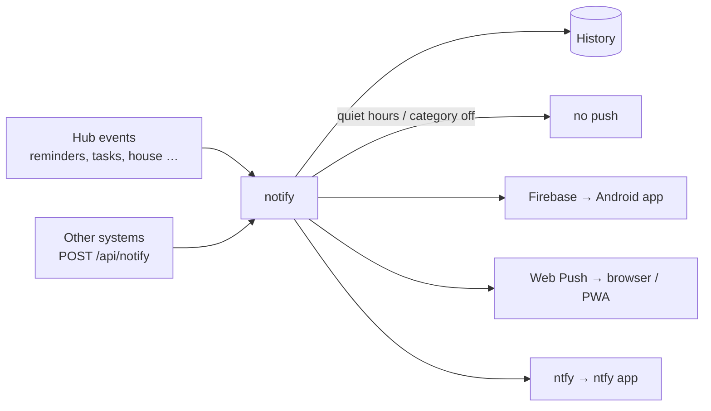

# Notifications

Every notification goes through one function on the server, `notify()` in `backend/app/services/notify.py`:

1. It is stored in the person's **history** (*More → Notifications*), always.
2. It is **suppressed as push** during the person's quiet hours or when they switched the category off.
3. Otherwise it is **pushed to every channel the person has**: Android app, browser/web app and ntfy, all at once.



## The channels

| Channel | For whom | Admin sets up | Person does |
|---|---|---|---|
| **Firebase (FCM)** | Android app | Firebase project and service account (`FCM_PROJECT_ID`, `FCM_SERVICE_ACCOUNT_FILE`), plus `google-services.json` in your own app build | Allow notifications on first start |
| **Web Push** | Browser and the web app on the home screen, including iPhone from iOS 16.4 | nothing: keys are generated on first start (own keys: `VAPID_PUBLIC_KEY`, `VAPID_PRIVATE_KEY`); contact address = first admin's email or `VAPID_EMAIL` | *More → Notifications & devices → Enable notifications on this device* |
| **ntfy** | Anyone with the ntfy app, especially iPhones with the sideloaded app | `ntfy` plugin: server and optional publish token, see [ntfy](ntfy.md) | Turn on *Notifications via ntfy*, subscribe to the shown topic in the ntfy app |

- **Categories:** `task_assigned`, `task_due`, `reminder`, `shopping`, `house`, `media`, `documents`, `stars`, `plugins`, `system`. Each person switches them on or off and sets quiet hours. Installed plugins send through the `plugins` category with a rate limit per plugin, see [Push notifications from plugins](plugins.md#push-notifications-from-plugins).
- **Buttons:** reminders carry *Done / In 1 hr / Tomorrow*. Android shows them through the app (FCM data message), the web app through its service worker (`app/web/push-sw.js`), ntfy as HTTP actions. All three use a short-lived token signed by the hub that is valid for one reminder and one person only.
- **Test:** *More → Notifications & devices → Send test notification* reports how many channels it reached.
- **Silent refresh:** after changes, the hub sends a silent FCM message so Android widgets update. This is not a visible notification.

## iPhone

| Way | Status |
|---|---|
| Web app on the home screen + Web Push | works |
| Sideloaded app + ntfy | works |
| Sideloaded app + Apple push (APNs) | **planned**, needs an Apple Developer account (99 €/year). Free sideloading has no push entitlement. |

Once the project has a developer account, the iOS app will register with Firebase like the Android app. Nothing changes on the server side. See the [roadmap](roadmap.md).

## Notifications from other systems

Home Assistant, Shelfarr, Paperless and others can notify the family through the hub, so the same quiet hours and channels apply:

```http
POST /api/notify
Authorization: Bearer fhs_…            # service key: More → Administration → Service keys
Content-Type: application/json

{"title": "🧺 Washing machine done", "body": "Please empty it",
 "to": "family", "category": "house", "route": "/today"}
```

- `to`: `family`, `admins`, a username, or a list of them.
- `silent: true` stores the notification in the history without push, for sources that already push themselves.

Ready-made Home Assistant snippets (REST command, script, "arrived home" reminders) are in [notification-sources.md](notification-sources.md).
